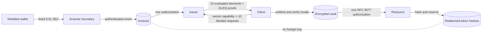

# 1 The Accountless Architecture

> **Part I — Foundations · Build checkpoint 1 of 3**

In this chapter you will not implement authentication yet. You will first turn
the privacy claim into repository rules that later code must satisfy. The
deliverable is a failing-or-passing architecture test, not a diagram that can
drift away from the code.

An API key looks harmless until you draw the joins. A conventional service
stores a customer, a payment, a key, and every request made with that key. Even
if each table has a different identifier, foreign keys turn the database into a
behavioral history. Hashing the key protects it at rest; it does not stop the
server from recognizing the same bearer on every request.

BlindPass changes the unit of authorization. The unit is a one-use capability
that says only “the issuer created one credit for this token class.” The buyer
does not authenticate. The redeemer does not present an invoice. Ten credits
mean ten independent random token inputs, not a balance row.

## 1.1 Step 1 — Separate facts before choosing cryptography

The system has four facts and deliberately refuses to create a fifth:

| Fact                                     | Necessary storage            | Forbidden join key |
| ---------------------------------------- | ---------------------------- | ------------------ |
| A payment reached an offer               | invoice, amount, chain state | user/account ID    |
| A paid invoice authorized issuance       | capability hash, state       | final token        |
| An issuer evaluated ten blinded requests | retry transcript             | unblinded token    |
| A token was spent                        | domain-separated token hash  | invoice ID         |

The missing fact is “invoice X produced redeemed token Y.” Database separation
alone does not remove it: if the issuer sees the unblinded token during
issuance, it can write the join elsewhere. Blind evaluation removes that direct
cryptographic observation.



The capability returned with an invoice is a secret reference, not an account.
The server stores its SHA-256 digest. Anyone holding it can inspect and issue
that invoice, so the client must protect it until issuance completes.

## 1.2 Step 2 — State the privacy claim narrowly

Under the VOPRF assumptions and correct implementation, an issuer cannot match
an issued request to a later valid token better than guessing among compatible
issuance transcripts. That claim does not hide the client's IP address, TLS or
browser fingerprint, payment observation, request time, or search text. Tor in
chapter 11 addresses part of the network layer; batching, common epochs, fixed
prices, and delayed redemption enlarge the practical anonymity set.

The honest-but-curious merchant follows the protocol while mining every
available field. A stronger malicious merchant may send a buyer-specific key,
class, count, or expiry. Chapter 6 makes those values client policy rather than
merchant choice. A global passive observer can correlate bursts at both ends;
this design does not defeat that observer.

```text
Cryptographic transcript        Network/behavioral transcript
------------------------        -----------------------------
blinded request B               source IP and TLS fingerprint
evaluated response Z            issue time and byte count
later token T                   redeem time and request contents

B does not identify T.          Metadata may still correlate the sessions.
```

## 1.3 Step 3 — Encode architectural absences as tests

Security review often focuses on code that exists. Privacy also depends on code
that must never appear. This test scans migration and API source for identity
columns, invoice joins in redemption, and request logging. It is not a proof,
but it turns accidental architectural drift into a failing build.

{{blindpass-include:tests/architecture.test.ts}}

Read the assertions as boundary tests. The `redeemed_tokens` check protects the
schema. The server-package check protects the redemption dependency direction.
The logging check protects the application configuration. Deployment proxies
and hosted database logs still require independent review.

Build this test in three passes. First assert that the migration contains a
`redeemed_tokens` table; this keeps a renamed or missing schema from producing a
false pass. Second reject identity-shaped columns and invoice references from
that table. Third read the server and API composition sources and reject payment
imports, invoice queries, and enabled request logging. Each pass constrains a
different layer, so a failure points to the boundary that moved.

Run the chapter's executable check:

```bash
pnpm exec vitest run tests/architecture.test.ts
```

## 1.4 Step 4 — Attack the mental model

Ask what happens if a developer adds `invoice_id` to `redeemed_tokens` “for
support.” Redemption immediately becomes linkable even though every curve
operation remains correct. Ask what happens if a reverse proxy records the
`Authorization` header. The database stays clean while logs become a replay
oracle and behavioral ledger. Ask what happens if every invoice receives a
unique expiry. The expiry embedded in the challenge becomes a cohort tag.

The design rule is therefore compositional: unlinkability survives only when
the cryptographic input, configuration policy, transport, storage, and
operations all refuse distinguishing data. The remaining chapters implement
that rule one boundary at a time.

### Build checkpoint

You should now be able to explain why deleting the user table is necessary but
insufficient, why a bearer token must be single-use, and why payment privacy and
credential unlinkability are separate properties.

Before continuing, keep `tests/architecture.test.ts` green. Chapter 3 will make
its schema assertions concrete.
