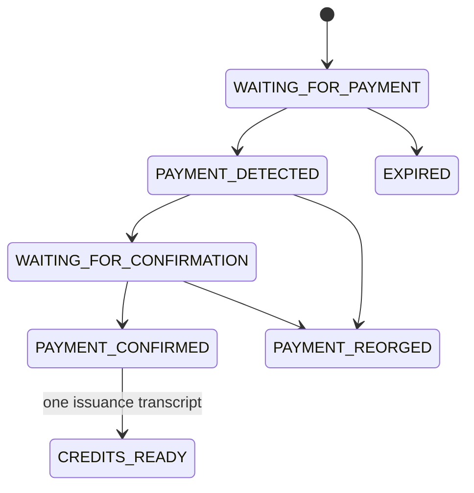

# 3 Monorepo Foundation & Schema Design

> **Part I — Foundations · Build checkpoint 3 of 3**

You will now create the packages, the shared vocabulary, and the first database
migration. Work in that order. Types make illegal states visible to the
compiler; the migration then makes concurrent processes obey the same rules.

The repository mirrors trust boundaries. Shared schemas know nothing about
PostgreSQL. The cryptographic package knows nothing about invoices. The server
package can verify and reserve a token without importing payment code. The API
is the composition root where those pieces meet.

```text
apps/api ───────┬──> @blindpass/server ──> @blindpass/privacy-pass
               ├──> @blindpass/zcash                 │
               └──> @blindpass/shared <──────────────┘

apps/web ──> @blindpass/client ──> @blindpass/privacy-pass
cli ───────> @blindpass/client
```

## 3.1 Step 1 — Scaffold one strict TypeScript world

The workspace uses ESM, bundler-style resolution, strict checking, DOM types
for Web Crypto, and Node types for the API and CLI. Package exports point at
TypeScript source so the lab runs directly through `tsx` and Vitest.

{{blindpass-include:pnpm-workspace.yaml}}

{{blindpass-include:tsconfig.json}}

Run the first structural gate before adding business logic:

```bash
pnpm typecheck
```

Create package manifests after the root compiler passes. Each package exports a
single source entry point during the lab. Keep dependency arrows one-way:
`shared` has no workspace dependency, `privacy-pass` depends on `shared`, and
`server` depends on both. If shared code imports the API, the boundary has
already collapsed.

## 3.2 Step 2 — Build encodings, errors, and signed types

The shared module is the vocabulary of the system. Its base64url encoder keeps
RFC-required padding: replacing characters is correct, stripping `=` would
produce a different spelling and fail the canonical round-trip check. Its
canonical JSON routine sorts keys recursively so an Ed25519 signature does not
depend on property insertion order.

{{blindpass-include:packages/shared/src/index.ts}}

Walk through the security-critical lines:

1. `BlindPassError` exposes stable public codes without leaking stack traces.
2. `b64` and `unb64` define one application encoding. A parser later demands
   `b64(unb64(input)) === input`, eliminating aliases.
3. `canonical` accepts only JSON-compatible values. `undefined`, cyclic
   objects, dates, and bigints must be normalized before signing.
4. `epochDates` derives shared calendar boundaries. Buyers cannot receive
   invoice-specific expiry values.
5. `.strict()` on manifests rejects hidden tagging fields.
6. Ed25519 keys are imported non-extractably for verification. The public key
   fingerprint is a SHA-256 trust anchor, not a user identifier.

Build the module in four passes. Start with `BlindPassError` and byte helpers so
every later package shares one encoding. Add canonical JSON and signature
verification next. Add epoch derivation before the manifest schema so dates are
policy outputs rather than arbitrary strings. Finish with invoice and credential
interfaces. Run `pnpm typecheck` after each pass; this catches accidental Node
`Buffer` dependencies that would break the browser package.

`localeCompare(..., "en")` is deterministic for this restricted ASCII schema,
but it is not a standards-track JSON Canonicalization Scheme. If documents will
cross implementations, adopt RFC 8785 and version the signed format before
deployment.

## 3.3 Step 3 — Translate privacy boundaries into tables

The migration stores money-side state and redemption-side state without a join
path. Amounts remain decimal strings; JavaScript floating point never touches
currency. A database constraint restricts redemptions to `reserved` or `spent`.

{{blindpass-include:infra/migrations/001_initial.sql}}

The same schema is represented with Drizzle for typed application queries.

{{blindpass-include:apps/api/src/db/schema.ts}}



`issuance_authorizations.invoice_id` is intentionally a primary key. One paid
invoice can authorize one batch. The stored response supports idempotent retry
of the exact same blinded request after a lost HTTP response. A different
request hash is refused, preventing repeated issuance from the same payment.

`redeemed_tokens` contains only a domain-separated SHA-256 token hash, epoch,
state, and timestamps. It has no invoice foreign key, client ID, IP address,
query, or raw token. The composite primary key is the concurrency primitive
used in chapter 5.

Write the migration from independent aggregates toward the sensitive boundary:

1. Create offers and issuer epochs.
2. Create invoices and payment events, which may reference one another.
3. Create one issuance authorization per invoice for retry control.
4. Create `redeemed_tokens` last and deliberately omit an invoice reference.
5. Add the composite primary key that chapter 5 will use as an atomic arbiter.

Then mirror those names in Drizzle. The SQL migration remains the deployment
authority; the Drizzle module provides typed queries and must not invent extra
columns.

## 3.4 Step 4 — Migrate and inspect the result

```bash
docker compose up -d postgres
pnpm db:migrate
psql "$DATABASE_URL" -c '\\d redeemed_tokens'
pnpm exec vitest run tests/integration.test.ts
```

Point tests at a disposable database. The integration harness creates random
schemas and drops them after each file; it still needs permission to create and
drop schemas. Never run destructive test setup against a production database.

### Part I checkpoint

At this point the workspace can express signed configuration, invoices,
credentials, and errors without an identity model. The schema can answer “was
this invoice paid?” and “was this token spent?” but has no column that answers
“who did either action?”

Commit or otherwise save this green state. Part II assumes strict types, a
running PostgreSQL instance, and the schema exactly as printed here.
