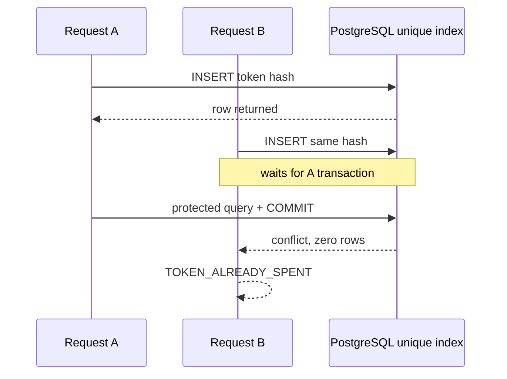

# 5 Redemption Middleware & Transactional Double-Spend Prevention

Cryptographic verification answers “did an issuer create this token?” It does
not answer “has somebody already spent it?” Two requests can verify the same
token concurrently. A read-then-write implementation lets both pass:

```text
request A: SELECT -> absent
request B: SELECT -> absent
request A: perform paid work; INSERT
request B: perform paid work; INSERT or fail too late
```

The reservation and the protected work must share one authoritative database
transaction.

## 5.1 Let the unique constraint choose the winner

{{blindpass-include:packages/blindpass-server/src/index.ts}}

Follow `redeem` line by line:

1. Parse one canonical RFC 9577 authorization value.
2. Try active and grace-period issuer keys until one verifies cryptographically
   and matches the requested token class.
3. Hash the raw token under the `blindpass-spent-token-v1` domain.
4. Begin a PostgreSQL transaction.
5. Insert a `reserved` row with `ON CONFLICT DO NOTHING RETURNING`.
6. If no row returned, report `TOKEN_ALREADY_SPENT`.
7. Execute the protected work through the same `TransactionSql` handle.
8. Mark the reservation `spent` and commit.

PostgreSQL's unique index serializes contenders. When A has inserted an
uncommitted key, B's conflicting insert waits. If A commits, B sees the conflict
and returns no row. If A rolls back, B may insert and continue. Application code
does not need a process-local mutex and remains correct across API replicas.



The `blindpass` factory fixes cost at one. Supporting arbitrary costs would need
an atomic selection and reservation of multiple independent tokens or a
different credential construction; silently looping would create partial-spend
failure modes.

## 5.2 Make the protected effect transactional

Reservation alone is insufficient if the paid side effect happens in another
database or an irreversible external service. BlindPass search executes with
the transaction handle, so a thrown error rolls back both result work and the
reservation. For email, object storage, or third-party APIs, use a transactional
outbox and define when the credit becomes spent. Exactly-once external effects
do not emerge from a SQL transaction by wishful thinking.

Long work holds a connection and a unique-index wait queue. Keep protected
database work short, set statement and transaction timeouts in production, and
cap concurrent requests. A crashed connection rolls back its reservation.
Stale `reserved` rows should therefore indicate a code path that committed
without the final update, not a normal crash recovery mechanism.

## 5.3 Prove the race at the boundary

{{blindpass-include:tests/replay.test.ts}}

Twenty promises present exactly the same valid credential. The assertion
requires one fulfilled result and one protected-handler call. Nineteen requests
must receive the stable conflict code. The second token makes the handler throw;
the next attempt succeeds, proving that reservation rollback follows work
rollback.

Run it against PostgreSQL rather than an in-memory imitation:

```bash
docker compose up -d postgres
pnpm exec vitest run tests/replay.test.ts
```

### Boundary attacks

A noncanonical encoding attack appends bytes or changes padding while retaining
the same parsed token. Parse-and-reserialize equality blocks it before hashing.
A database outage returns a service error and cannot authorize work. A token
from a valid issuer but another class fails before insertion. A replay after
epoch rotation still reaches the correct grace-period verifier and the same
epoch-scoped primary key.

### Checkpoint

The database is now part of the authorization proof. No API replica can spend a
token until PostgreSQL grants it the unique reservation, and no reservation
survives failed transactional work.
