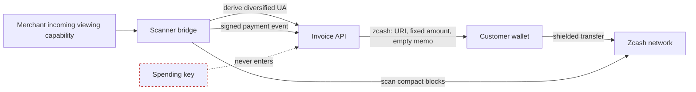

# 7 Shielded Payment Architecture (Zcash Orchard)

> **Part III — Payments · Build checkpoint 1 of 2**

This chapter builds the payment port before connecting a scanner. Start with
exact value conversion, define the watcher interface, and implement a mock that
cannot be confused with a real wallet. Chapter 8 will implement the production
adapter and invoice transitions.

Privacy Pass hides the relationship between issuance and redemption. It does
not hide the payment itself. BlindPass therefore accepts a fixed ZEC amount at
a fresh diversified Unified Address whose receiver set includes Orchard and
excludes transparent P2PKH/P2SH receivers.

## 7.1 Step 1 — Draw the custody boundary

ZIP 316 defines Unified Addresses as containers for one or more receiver types.
An encoded string that merely begins with a familiar prefix is not proof of an
Orchard receiver. Address parsing and receiver inspection belong in established
Zcash tooling at the scanner bridge. The TypeScript API demands that the bridge
return its validation result and then enforces the required policy.



BlindPass does not bundle a wallet, light client, or mainnet address derivation
library. `ScannerPaymentWatcher` is an explicit adapter contract for separately
deployed, audited Zcash infrastructure. The API needs incoming viewing and
address derivation capability through that bridge; it does not need a spending
key.

## 7.2 Step 2 — Represent value without floating point

One ZEC equals 100,000,000 zatoshis. Binary floating point cannot exactly
represent most decimal fractions, so `Number(amount) * 1e8` eventually accepts
or rejects the wrong payment. Parse the decimal syntax and convert with
`BigInt`.

{{blindpass-include:packages/zcash/src/index.ts}}

Build the file from pure functions toward effects:

1. Define and export `PaymentEventSchema`; every adapter will validate the same
   event shape.
2. Define `PaymentDestination` and `PaymentWatcher` without mentioning a
   concrete scanner vendor.
3. Implement `zatoshis` and `paymentUri` as pure, directly testable functions.
4. Implement `MockPaymentWatcher` last, using the same interface and event
   subscription behavior as production.

`zatoshis` accepts at most eight fractional digits, pads on the right, and
returns an exact integer. Leading zeros are harmless. Signs, exponent notation,
whitespace, and a ninth decimal place are rejected. Production policy should
also cap the whole-number length before conversion to bound resource use.

The payment URI carries the offer amount and no memo. A unique memo would work
as a tracking tag visible to the merchant scanner. The address is already
invoice-specific, so the memo adds no routing value.

`MockPaymentWatcher` implements the same interface but returns an unmistakable
`SIMULATED-NOT-PAYABLE-...` address. It tests the state machine without claiming
chain connectivity. Never make a development address resemble a valid mainnet
address.

## 7.3 Step 3 — Fix denomination and cohort shape

The current offer is ten credits for `0.01` ZEC. Fixed price avoids encoding a
customer or invoice in the last zatoshis. Fixed batch size avoids telling the
redeemer which one-off quantity was bought. This is a privacy parameter, not
just pricing UX.

The merchant still observes incoming notes using its viewing capability and
may know approximate amount and time. Shielded Zcash removes the public-chain
transparent linkage that a transparent address would create; it does not make
the merchant forget the payment it receives. A later direct redemption from the
same IP can still correlate the buyer.

Run exact arithmetic tests:

```bash
pnpm exec vitest run tests/scanner.test.ts -t "fixed decimal"
```

Try these boundary cases in a Node 22 REPL through `tsx`:

```bash
pnpm exec tsx -e 'import { zatoshis } from "./packages/zcash/src/index.ts"; console.log(zatoshis("0.01"), zatoshis("0.00000001"))'
```

Expected output is `1000000n 1n`.

### Payment threats

An underpayment must not round up. A reused address lets the scanner cluster
invoices. A transparent receiver leaks public graph data. A unique amount or
memo fingerprints the purchase. A zero-confirmation event can disappear in a
reorganization. Chapter 8 treats scanner input as an authenticated,
replayable, reversible event stream rather than a final callback.

### Build checkpoint

You now have a payment abstraction with exact units and an honest mock. Real
custody stays outside the API, while the scanner contract requires a validated,
diversified Unified Address with an Orchard receiver.

Before continuing, make the arithmetic test pass without importing Fastify or
PostgreSQL. That independence is the reason the payment package remains easy to
audit.
