# 8 Watchers, Webhooks, and Reorg Resistance

Payment webhooks cross two trust boundaries: an external scanner asserts chain
state, and an HTTP parser wants to transform the request before authentication.
BlindPass authenticates the exact received bytes, deduplicates events, and
allows pre-issuance confirmation state to move backward on a reorganization.

## 8.1 Authenticate raw bytes

{{blindpass-include:packages/zcash/src/scanner.ts}}

The bridge signs `timestamp + "." + rawBody` with HMAC-SHA-256. Verification
rejects missing or malformed headers, timestamps more than five minutes away,
and non-hex signatures. Both digest buffers are known to be 32 bytes before
`timingSafeEqual`, avoiding its unequal-length exception and a length oracle.

The timestamp window limits captured-request replay. Database event IDs provide
durable idempotency. In a multi-scanner deployment, synchronize clocks and
define a globally unique event-id namespace. HMAC does not itself prevent the
same valid request from being delivered twice.

Parsing JSON before verification is wrong because equivalent JSON documents
can have different byte sequences. Fastify's scoped content-type parser keeps
the body as a string only for the webhook route. The full composition root shows
the parser, security headers, error mapping, and privacy-safe logging policy.

{{blindpass-include:apps/api/src/app.ts}}

The parser is registered inside a Fastify encapsulation scope. Other JSON
routes keep normal parsing and Zod validation. `bodyLimit` caps memory before
HMAC processing. The route passes raw text and header values directly to the
watcher.

## 8.2 Drive invoice state transactionally

{{blindpass-include:apps/api/src/invoices.ts}}

`InvoiceService.payment` starts by locking the invoice row. It converts both
amounts to zatoshis and rejects an underpayment. It inserts the event ID with
`ON CONFLICT DO NOTHING`; a duplicate returns without applying state twice.

For a forward event, confirmation count selects `PAYMENT_DETECTED`,
`WAITING_FOR_CONFIRMATION`, or `PAYMENT_CONFIRMED`. Only the confirmed state
creates an issuance authorization. For a reorg before issuance, the method
marks the invoice `PAYMENT_REORGED` and deletes an unused authorization in the
same transaction.

```mermaid
stateDiagram-v2
  PAYMENT_DETECTED --> WAITING_FOR_CONFIRMATION: confirmations > 0
  WAITING_FOR_CONFIRMATION --> PAYMENT_CONFIRMED: confirmations >= policy
  PAYMENT_DETECTED --> PAYMENT_REORGED: reorg
  WAITING_FOR_CONFIRMATION --> PAYMENT_REORGED: reorg
  PAYMENT_CONFIRMED --> PAYMENT_REORGED: reorg before issuance
  CREDITS_READY --> CREDITS_READY: post-issuance reorg; record merchant risk
```



After issuance, the merchant cannot revoke individual anonymous tokens without
adding a linkage or revocation tag. A post-issuance reorg is recorded as an
aggregate audit event and becomes merchant risk. Choose confirmation depth and
invoice value accordingly.

## 8.3 Test byte identity and receiver policy

{{blindpass-include:tests/scanner.test.ts}}

Appending a single space keeps the JSON value valid but changes the signed
bytes, so verification fails. The stale timestamp case fails before dispatch.
The fake scanner response deliberately contains a transparent receiver and is
rejected even though it claims `validated: true`.

Run payment boundary and state-machine tests:

```bash
pnpm exec vitest run tests/scanner.test.ts tests/integration.test.ts
```

### Operational pitfalls

Configure the reverse proxy to preserve the body and signature headers. Do not
log raw webhook bodies: transaction IDs and addresses are payment metadata.
Rotate webhook secrets with an overlap protocol that identifies which secret
signed an event without accepting arbitrary algorithms. Rate-limit before
expensive JSON processing, but do not key permanent customer state by source
IP. Treat scanner timeouts as unknown state and poll `getInvoice`; do not mark a
payment absent merely because a webhook was delayed.

### Checkpoint

The payment pipeline now accepts exact, authenticated scanner bytes and maps
them through an idempotent PostgreSQL state machine. Reorganizations revoke
unused authorization while preserving the unlinkability of credentials already
issued.
