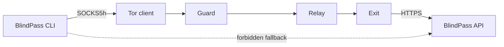

# 11 Network Privacy & Routing Through Tor

If the same source IP buys and immediately redeems a token, the issuer does not
need to break the VOPRF. Network metadata supplies the correlation. Tor adds a
separate routing layer for the Node CLI, provided every destination lookup and
request stays inside the SOCKS tunnel.

## 11.1 Require remote DNS resolution

The `socks5h` scheme means the proxy resolves hostnames. Plain `socks5` may
resolve DNS locally, exposing destinations to the local resolver and network.
BlindPass accepts only `socks5h://` and rejects invalid schemes.

{{blindpass-include:cli/src/tor.ts}}

Before returning a transport, the function requests the Tor Project's exit
check through the proxy and requires `IsTor: true`. This is a reachability and
routing assertion at that moment, not a guarantee of anonymity. The check
itself reveals to the Tor exit-check service that a Tor client is testing its
connection.

The returned transport attaches the same proxy agent to every request, rejects
redirects, sets a timeout, and converts `node-fetch` responses to the Web
`Response` interface consumed by the SDK. Any exception becomes
`TOR_NOT_AVAILABLE`; there is no direct retry.



Localhost is rejected because a public Tor exit cannot connect back to the
CLI's loopback interface. For development, use direct mode. To test end to end
through Tor, expose a deliberate HTTPS staging host or onion service and set
`BLINDPASS_API_URL` accordingly.

## 11.2 Fail closed under attack

{{blindpass-include:tests/tor.test.ts}}

The first test catches a local-DNS downgrade. The second allocates and closes a
loopback port, then proves an unavailable proxy raises the Tor-specific error.
There is no assertion that direct fetch was avoided because the implementation
contains no direct transport branch after Tor selection; code review and the
single injected transport boundary preserve that property.

```bash
pnpm exec vitest run tests/tor.test.ts
docker compose --profile tor up -d tor
BLINDPASS_API_URL=https://staging.example pnpm blindpass search --tor "privacy pass"
```

Do not point the final command at a host you do not control while testing real
credentials.

## 11.3 Know what Tor does not normalize

Tor separates the destination from the source IP as observed by ordinary
endpoints. It does not hide query contents from BlindPass, prevent application
fingerprinting, equalize request sizes, or defeat a sufficiently capable global
observer correlating timing and volume. The Node TLS handshake may differ from
the browser's. A unique API path, header set, or issuance batch time can still
stand out.

Delay redemption, use common batch sizes, avoid invoice-derived headers, and
keep request shapes stable. OHTTP is a future option for separating client
network identity from an application request through a relay, but it brings key
configuration, relay trust, replay, and padding choices of its own.

### Checkpoint

Tor mode now has a crisp invariant: either a verified SOCKS5h path carries the
request or the command fails. It never silently exchanges privacy for
availability.
