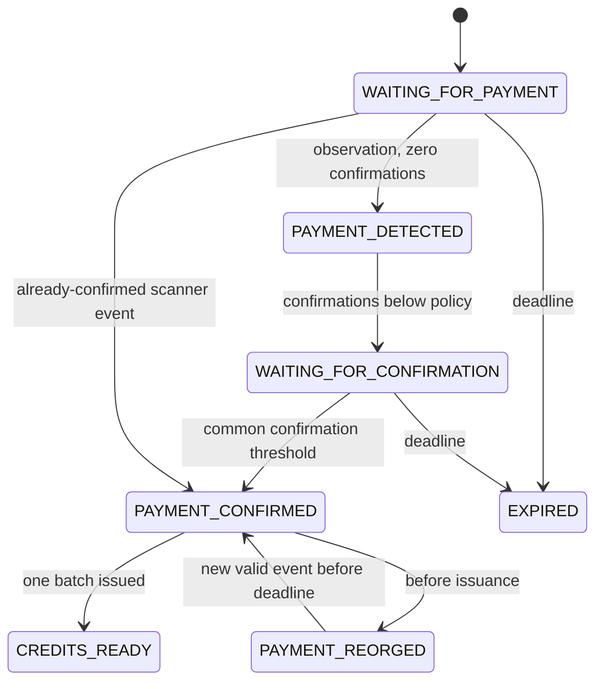

# Architecture

BlindPass separates purchase authorization from resource authorization. The accountless model is intentional: there is no user table, API key, server-side session, or persistent browser identifier.

```mermaid
flowchart LR
  W[External Zcash wallet] -->|ZIP-321 shielded payment| M[Merchant wallet]
  M --> S[Read-only scanner]
  S -->|Authenticated event| P[Payment authorization]
  P --> I[Privacy Pass issuer]
  C[Client: generate and blind locally] -->|10 blinded requests + capability| I
  I -->|Evaluations + proofs| U[Client: verify and unblind]
  U --> V[Encrypted local credential vault]
  V -->|Later: one credential, no invoice ID| A[Protected API]
  A --> R[Verifier + common epoch policy]
  R --> D[(Spent token hashes)]
  D --> Q[Local search]
  Q --> O[Response]
```



The graph describes messages, not a stored foreign-key chain. The issuer-to-client blinding boundary prevents a direct cryptographic join between its request transcript and a final credential. An attacker can still correlate metadata across those stages.

## 1. Invoice and signed terms

The client first obtains the signed issuer manifest, checks the expected or pinned merchant identity, and enforces the common epoch policy. `POST /api/invoices` creates an opaque UUID-based invoice ID and a separate random 256-bit capability. Only the capability hash is stored in PostgreSQL. Knowing the invoice ID alone does not authorize reading or issuance.

The invoice binds offer, fixed decimal amount, ten credits, token class, common issuer-configuration hash, payment destination, confirmation policy, payment deadline, issuance deadline and refund policy under an Ed25519 signature. The client verifies the signature and reconstructs the payment URI from the signed destination and amount. The invoice signature provides operational integrity; it does not provide blindness.

Each invoice receives a distinct destination. In real mode the scanner is responsible for actual diversified Orchard address derivation and validation. Mock mode uses an obviously non-payable destination. No invoice identifier is encoded into an amount or memo. The sample mock address uses the local invoice ID as a deterministic simulator key and must never be confused with a real diversified address.

## 2. Payment detection and authorization

`PaymentWatcher` defines `createInvoice`, `getInvoice`, and `subscribe`. The deterministic mock implementation exposes development-only payment events. The scanner implementation makes authenticated bridge requests and accepts HMAC-authenticated webhook bytes with a five-minute timestamp window.



Payment handling locks the invoice and deduplicates event IDs in a transaction. Amount comparison uses integer zatoshis, not floating point. A sufficient, confirmed observation creates one `issuance_authorizations` row. An expired invoice cannot authorize issuance, even if funds arrive late. Those funds require manual handling under the disclosed refund policy.

Before issuance, a reorg revokes authorization. After issuance, a reorg increments an aggregate operational event; it cannot target already unblinded credits without adding a linkage mechanism. This is merchant credit risk, mitigated by appropriate confirmation policy.

## 3. Blinding and issuance

The client creates ten independent RFC 9578 token inputs under one common challenge. Nonces and blinding state remain local. The request body contains only a capability, configuration hash and ten blinded requests. It contains no final credential, unblinded nonce or secret blinder.

The issuance transaction locks invoice and authorization rows, checks payment, count, deadline and configuration, and evaluates the blinded requests using the shared epoch key. It stores a request digest and evaluated responses, then marks the authorization completed and invoice credits-ready. These are blind transcript values, not token hashes or final credentials.

Identical-transcript retries return the saved responses. A different request digest gets `ISSUANCE_ALREADY_COMPLETED`. Concurrent issuance cannot produce two paid batches. This avoids silent inflation during retries.

## 4. Proof verification, unblinding and storage

The response’s merchant-signed manifest is checked against the trusted configuration before finalization. The library validates DLEQ proofs while finalizing. Only a fully successful batch is stored.

The browser encrypts state with AES-256-GCM and persists a non-extractable key in IndexedDB. Web Locks serialize cross-tab mutations. The CLI uses AES-256-GCM with scrypt-derived keys backed by Secret Service or a user passphrase, private filesystem permissions and an exclusive lock file. Invoice capabilities are encrypted alongside local state; credentials themselves carry no invoice metadata.

An identical in-memory issuance retry is possible after a transport interruption. Persisting and recovering the library’s internal blinding state is not implemented. A process crash after server commitment can therefore lose credits. The UI must not claim account recovery or automatic replacements.

## 5. Redemption and resource execution

The client sends the RFC 9577 authorization header with a single token. It does not send invoice data, cookies, account IDs, API keys, or a stable client identifier. The search query is visible to the destination and is used transiently for PostgreSQL full-text search.

The verifier checks canonical wire encoding, the VOPRF authenticator, epoch key ID, validity interval and expected application challenge/class. The token hash is `SHA-256("blindpass-spent-token-v1" || canonical_token_bytes)`.

```mermaid
sequenceDiagram
  participant C as Client
  participant A as API verifier
  participant D as PostgreSQL
  participant S as Local search
  C->>A: PrivateToken credential + query
  A->>A: Verify authenticator, context, epoch
  A->>D: BEGIN; INSERT hash reserved ON CONFLICT DO NOTHING
  alt Existing hash
    D-->>A: Conflict
    A-->>C: TOKEN_ALREADY_SPENT
  else Reserved by this transaction
    A->>S: Execute fixed-cost query
    alt Success
      S-->>A: Results
      A->>D: UPDATE spent; COMMIT
      A-->>C: creditConsumed=true
    else Failure before irreversible work
      A->>D: ROLLBACK
      A-->>C: SERVICE_TEMPORARILY_UNAVAILABLE
    end
  end
```

PostgreSQL's unique constraint forces concurrent insertions of the same hash to wait for the winner. Exactly one successful transaction can spend it. A transaction rollback releases the reservation. The included search has no external irreversible side effects; consumers must not generalize this rollback policy to arbitrary payments or costly remote operations.

Clients remove the credential locally before transport. On an explicit service-unavailable or invalid-request response they restore it. On an ambiguous network failure they conservatively retain the removal: the merchant may already have spent it. Automatic retry of a new token could charge twice, so it is not performed.

## 6. Data separation and observability

| Data | Stored | Deliberately absent |
| --- | --- | --- |
| Invoice | Payment destination, amount, capability hash, epoch, signed terms | User profile |
| Payment event | Invoice, transaction observation, confirmations | Spending key |
| Issuance authorization | Invoice, blinded-request digest, evaluated responses, count | Final token or redemption hash |
| Redeemed token | Domain-separated hash, common epoch, state, timestamps | Invoice ID, IP, query, raw token |
| Audit event | Aggregate event kind and count | Per-person histories |

The development merchant screen queries purchases and redemptions independently and deliberately provides no matching relation. Timestamps still permit inference; schema separation does not erase operational metadata. Search queries are not stored as history. Reverse proxies, hosting services, scanner logs and backups must be configured independently.

## 7. Refund and replacement flow

An operator can assess an **unissued** paid invoice using its capability and payment evidence. The MVP discloses manual contact/refund handling and never automatically creates a mainnet refund. After issuance, the server cannot prove which surviving credits belong to a purchase. It therefore cannot safely replace an allegedly lost batch or individually revoke its tokens. Anonymous refund credentials and a more complete fair-exchange/recovery protocol remain future work.

## 8. Epoch and key lifecycle

The active UTC month has a shared key persisted in `.secrets/` for development or supplied explicitly in production. The database refuses replacement of a registered epoch key. Previous epoch keys remain available through seven-day verification grace. A service restart with the next epoch key is required at the boundary. Production deployments need coordinated rotation, protected secret backups, access controls, monitoring and eventual key destruction after retention obligations end.
